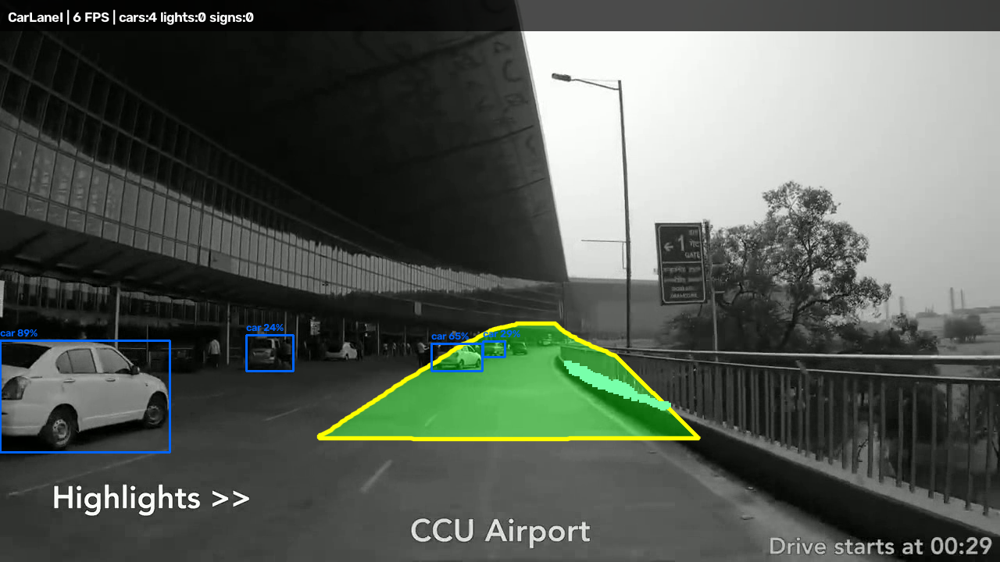

# CarLaneI — Project Summary (What I Built & Improved)

A real-time driving-perception system for **Indian road conditions**, running four
computer-vision tasks live at **~23 FPS on 720p** on a single laptop **RTX 3050
(6 GB)**. This document summarises what I did, the problems I solved, and the
**measured** accuracy improvements — written so it can be turned directly into
resume bullets.

> Every number below is measured on a held-out validation set or an instrumented
> run on real dashcam footage. Nothing is estimated.

---

## 1. One-line summary

Built and deployed a 5-model real-time perception pipeline (lane, sign,
traffic-light, vehicle) for Indian roads, **trained 3 models from scratch on real
datasets**, improved ego-lane accuracy from **IoU 0.06 → 0.59** and sign detection
to **mAP50 ~0.91**, and shipped it as a browser-based demo at **~23 FPS** on a 6 GB
laptop GPU.

---

## Example output

*A real annotated frame — green = detected ego lane, yellow = lane border, blue =
vehicle detections with confidence, top strip = live HUD. All drawn in real time.*

---

## 2. What the system does

Processes dashcam video and detects, in real time:
- **Ego-lane** — the exact lane the car is driving in (not just the road).
- **Traffic signs** — classified into 4 categories (prohibitory / mandatory / danger / other).
- **Traffic lights + state** — red / green / yellow / off.
- **Vehicles** — car / motorcycle / bus / truck.
- Plus a **lane-departure warning** derived from the lane-centre offset.

Delivered two ways: a **FastAPI web app** (upload a clip, watch live or download the
annotated result) and a **one-click standalone live window**.

---

## 3. What I actually did (my contributions)

### a) Trained 3 deep-learning models from scratch on real data
| Model | Task | Dataset (real) | Result (held-out) |
|---|---|---|---|
| Ego-lane segmenter | lane segmentation | BDD100K (~28k masks) | **mask mAP50 0.972** |
| Sign detector | sign detection, 4 classes | GTSDB + 7.5k Indian dashcam | **mAP50 ~0.91** |
| Light-state detector | traffic-light R/Y/G/OFF | Bosch Small Traffic Lights | **mAP50 ~0.58** |

### b) Built the real-time inference pipeline
- Integrated 5 models (3 trained + YOLOP + YOLOv8-COCO) into one pipeline.
- Compiled every model to **TensorRT FP16** for GPU acceleration.
- Added **frame-skipping with caching** so heavy models run every 3rd–6th frame while overlays stay continuous — this is what makes real-time possible on 6 GB.

### c) Built classical-CV post-processing that measurably cleans up detections
- A **geometry gate + temporal voting** for traffic lights that cut false positives below the horizon from **53% → 0%** and state-flicker from **11% → 1%**.

### d) Shipped a full web application (frontend + backend)
- FastAPI backend with a single-GPU job queue, live **MJPEG streaming**, and H.264 transcoding for browser playback.
- Frontend with upload/drag-drop, live-preview vs final-render, full-video streaming, stop control, and a built-in presentation of the results.

### e) Validated honestly on real Indian footage
- Full-pipeline runs on Kolkata, Mumbai, and NH-44 night drives, plus a measured **day-vs-night** evaluation.

---

## 4. How I improved the accuracy (the key story)

The core engineering story is **replacing weak off-the-shelf / hand-tuned
components with models trained on real target-domain data**, proven by measurement.

### Improvement 1 — Ego-lane: heuristic → trained model
| Approach | Mean IoU | Finds lane (IoU ≥ 0.5) |
|---|---|---|
| Hand-tuned OpenCV corridor (before) | 0.06 | 4% |
| **Trained segmentation model (after)** | **0.59** | **69%** |

**+0.53 IoU** — I first tried an off-the-shelf model (UFLD), which **failed on our
camera geometry** (placed lanes in the sky). That negative result is what drove the
decision to train on real BDD100K lane masks. Scaling training data from 8k → 28k
images lifted the stricter mAP50-95 from **0.63 → 0.81**.

### Improvement 2 — Traffic signs: synthetic + saturated classifier → real single-stage
| Approach | Behaviour |
|---|---|
| Old: detector on synthetic crops + 43-class classifier | 96.8% on paper but **saturated** — gave 100% confidence on signs it had never seen; ~57% real-world presence |
| **New: single-stage detector on real data, 4 super-classes** | **mAP50 ~0.91** held-out, trustworthy output |

I collapsed to 4 shape/colour super-classes (what a sign reliably supports) and
merged German GTSDB with 7.5k real Indian dashcam signs — removing the
over-confident wrong predictions.

### Improvement 3 — Traffic lights: pixel heuristic → learned state + temporal gate
Replaced a hand-written colour heuristic (weakest at night) with a **trained
detector that outputs state directly**, stabilised by temporal voting. Calibrated
the confidence gate to Indian footage, taking live light detections from
**0 (unusable) → working** on Kolkata/Mumbai clips.

### Improvement 4 — Performance optimisation (profiling-driven)
- Profiled the pipeline and found one model was accidentally exported as **FP32 (166 MB, 73 ms/frame)** — the real bottleneck. Re-exporting as **FP16 (86 MB, 16 ms)** lifted live throughput from **~13 → ~23 FPS**.
- Added a fast live-cadence mode (wider frame-skip) for smooth real-time preview.

---

## 5. Measured results (headline numbers)

| Metric | Value |
|---|---|
| Ego-lane segmentation (mask mAP50) | **0.972** |
| Ego-lane improvement over heuristic (IoU) | **0.06 → 0.59 (+0.53)** |
| Sign detection (mAP50, 4-class) | **~0.91** |
| Traffic-light state (mAP50, Bosch) | **~0.58** |
| Traffic-light false-positive reduction | **53% → 0%** |
| Traffic-light state-flicker reduction | **11% → 1%** |
| Live throughput (720p, 5 models, RTX 3050 6 GB) | **~23 FPS** |
| Inference optimisation (one model, FP32→FP16) | **73 ms → 16 ms** |

---

## 6. Tech stack

- **Deep learning:** PyTorch, Ultralytics YOLOv8 / YOLOv8-seg, YOLOP
- **Inference:** TensorRT (FP16), ONNX
- **Classical CV:** OpenCV (geometry gates, temporal voting, morphology)
- **Backend:** FastAPI + Uvicorn (job queue, MJPEG live stream, H.264 transcode)
- **Frontend:** HTML + Tailwind + vanilla JS
- **Training infra:** Kaggle 2×T4 + Google Colab T4 (parallel training); local RTX 3050 for TensorRT export
- **Datasets:** BDD100K, GTSDB, Indian dashcam signs, Bosch Small Traffic Lights

---

## 7. Resume-ready bullet points (copy/adapt)

- Built a real-time multi-task driving-perception system (ego-lane, traffic-sign, traffic-light-state, vehicle detection) running **5 deep-learning models at ~23 FPS on a 6 GB laptop GPU** using **PyTorch + TensorRT FP16**.
- **Trained 3 CNN models from scratch** on real datasets (BDD100K, GTSDB + Indian dashcam, Bosch), achieving **ego-lane mask mAP50 0.972** and **sign-detection mAP50 ~0.91** on held-out data.
- Improved ego-lane detection **from IoU 0.06 to 0.59 (+0.53)** by replacing a hand-tuned heuristic with a trained segmentation model, after proving an off-the-shelf model failed on the target camera geometry.
- Designed a classical-CV temporal gate that **cut traffic-light false positives from 53% to 0%** and state-flicker from **11% to 1%**.
- **Profiled and optimised** the pipeline — identified an FP32 export bottleneck and halved its latency (**73 ms → 16 ms**), lifting live throughput from **13 to 23 FPS**.
- Shipped the full stack as a **FastAPI web app with live MJPEG streaming** and a one-click demo, validated on real Kolkata / Mumbai / night-highway footage.

---

## 8. Honest limitations (shows engineering maturity)

- Traffic-light detector is low-confidence on Indian signals (Bosch is US/German domain) and yellow is under-represented in training data.
- Sign detector sometimes confuses `danger`↔`other` due to class imbalance in the Indian data.
- Night-time traffic-light recall drops to ~⅓ of daytime (a known field-wide challenge).
- Ego-lane model is BDD-trained; an Indian-data variant underperformed (mAP50 0.14) so BDD remains the default.

**Next steps:** fine-tune the light detector on Indian signals, rebalance the sign
dataset, and add IoU-based light tracking.
